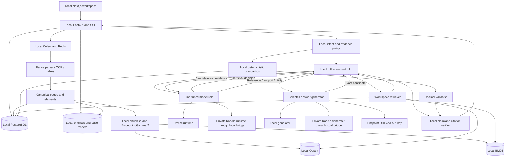

# ARCHITECTURE.md

## 1. Purpose and relationship to source

DocuMind AI adapts the supplied *Self-RAG Project Spec* (7 pages; `reference/original_self_rag_spec.pdf`) into a **multimodal document intelligence and cross-document verification** application. It preserves the PDF's QLoRA method, hybrid retriever, reflection-token branching and naive RAG comparison. ADR-031 replaces the gated Llama base with Qwen3-4B-Instruct-2507. It extends the corpus, ingestion, storage, APIs, UI and evaluation. The departure list is in [`docs/CHANGES_FROM_PDF.md`](docs/CHANGES_FROM_PDF.md).

ADR-042 makes this a local-only application. Next.js, FastAPI, workers, files, PostgreSQL, Qdrant, embedding, reranking and verification run on the user's device. Model compute is selected independently for the fine-tuned reflection role and answer generation. The source PDF's Hugging Face deployment and earlier hosted application plans are superseded.

## 2. Logical architecture



The fine-tuned model comprises its matching Qwen base, saved adapter, tokenizer and reflection rows. It can run on the device or private Kaggle. The generator can use a different local, Kaggle or endpoint model. The trained runtime conditions its critic labels on that exact candidate. The backend ranks candidates and checks their source support independently.

Baseline generation and evidence-only QA remain available without the fine-tuned runtime. The integrated checkpoint path can still generate and judge its own candidates for compatibility and same-base experiments. The split path records both model identities and its execution strategy.

### Execution boundary

All application services bind to loopback. Docker services may listen internally for container networking, while published ports remain on 127.0.0.1. External model calls are outbound choices. Native documents and indexes remain on the device.

`scripts/run_kaggle_model.py` manages one explicitly requested private model session and provides an authenticated loopback inference bridge. Only inference routes cross it. The notebook-execution URL and upstream token stay in owner-only state. The existing watcher, fixed allocation expiry and remote process guardian bound its lifecycle. The local admin supplies Kaggle credentials through the configured CLI. Query submission never allocates a notebook.

## 3. Data flow A: upload and index

1. UI requests a document upload for an authorized workspace; API validates MIME type, extension, size and upload limits.
2. Original file is durably stored with SHA-256. Commit request idempotency key, document, queued extraction version and durable job together; a dispatcher submits job IDs to Celery and recovers missed dispatches.
3. A leased Celery attempt moves extraction to `processing`, extracts native text with PyMuPDF, and uses the local PaddleOCR adapter for image/low-text pages when enabled. Stage writes are idempotent and fenced by lease token. Page writes share a nonblocking document advisory lock with physical cleanup, preventing a cancelled worker from recreating a render after successful deletion.
4. Phase 1B uses PyMuPDF for native ruled tables and OpenCV grid geometry plus PaddleOCR for scanned ruled tables. Store page/element geometry, extraction identity, confidence and cell coordinates. OCR/table output requires review; Docling, general layout and automatic cross-page table linking remain extensions (ADR-024).
5. Normalize documents into canonical pages/elements; retain raw extraction separately from any model interpretation.
6. Commit validated immutable extraction records and preview availability independently of indexing. Phase 1A stops here; needs-review output remains preview-only.
7. Phase 2 accepts a publication request that freezes the workspace's eligible PDF versions. The worker constructs hybrid-v3 chunks and verifies Qdrant and BM25 membership before advancing the PostgreSQL publication pointer. An older complete version remains searchable during failed reprocessing. Deletion revokes affected snapshots and runs immediately.

The full dispatch/lease/publication protocol is authoritative in [docs/INGESTION.md](docs/INGESTION.md). Extraction state, index state and derived visibility are defined in [docs/DATA_MODEL.md](docs/DATA_MODEL.md). No distributed transaction across PostgreSQL, object storage and Qdrant is assumed.

**Correctness constraints:** A citation must remain resolvable after chunks are reindexed. Source `element_id` and page anchor must not be replaced by a fabricated passage label. Keep parser and embedding versions so the same upload can be reproduced.

## 4. Data flow B: document QA

1. UI creates a query with question, document IDs, mode and an idempotency key. API persists a queued run/job and returns 202; the browser polls the result or subscribes to GET events. Pin the authorized document set, publication, connection configuration version and admitted model/release identity once. Model-backed runs require the selected connection to support the resolved mode.
2. Policy router classifies `GENERAL`, `DOCUMENT_QA`, `CROSS_DOCUMENT`, `CALCULATION`, or `UNSUPPORTED`; any selected-document fact request forces evidence retrieval.
3. Baseline path retrieves hybrid top 5 passages and applies the bounded evidence-v1 verifier. Direct field answers and calculations require verified typed facts; broader unsupported questions abstain even when search returns hits. Identity, raw quote validity and substantive support are separate checks in [docs/EVIDENCE.md](docs/EVIDENCE.md).

4. The optional trained path follows selfrag-v1: decode a decision, apply policy once, retrieve or reuse evidence, generate bounded candidates with the selected generator, obtain trained critic labels and independently verify them. V1 stops/restarts reconstructed contexts, uses greedy segment selection and detects repeated identical retrievals. The shared retrieval-attempt cap is 3; the protocol declares deviations from the paper.
5. Citation verifier checks that cited passages were retrieved, belong to the authorized workspace, map to source pages and substantively support the claims. It can mark `insufficient_evidence` or return an abstention.
6. On model/connection failure, persist an explicit error. A different provider or a downgrade from Self-RAG requires user selection and a new run; never silently forward evidence elsewhere.
7. Persist ordered trace events and exactly one durable terminal answer/error outcome. GET SSE replays with sequence cursors and may redeliver events; clients deduplicate. Disconnect does not restart/cancel work, explicit cancellation does. Trace metadata excludes hidden reasoning and raw unverified answer tokens. See [docs/API_CONTRACT.md](docs/API_CONTRACT.md).

The trained path budgets complete serialized contexts with the exact admitted generation tokenizer and chat-template hash. Oversized field evidence becomes an explicitly traced contiguous source window preserving its complete field line and raw offsets. Independent verification still reads the complete pinned source, including table qualifiers and contradictions. Stored result, event and citation reads repeat that support check. Human release review binds actual generated outcomes and the frozen corpus to the immutable checkpoint; the runtime consumes and revalidates the recorded review artifact.

**Important distinction:** A fully streamed token-by-token loop may need custom model control rather than a naive `pipeline()` call. Implement and test generation boundaries and context-injection semantics explicitly; do not treat a log of tags as equivalent to model control.

The operator-only Kaggle path has a durable creation receipt and fixed allocation expiry, an independent local exact-session cancellation watcher, and a separate remote model-process guardian covering installation/loading. It remains outside the public connection API. The selected-model diagnostic exercises actual PDF-to-answer components in disposable stores with explicit experimental admission/transport injection; it does not authorize production admission. [Lifecycle and evidence](DECISIONS.md#adr-038-bound-operator-sessions-and-preserve-creation-receipts-for-recovery).

## 5. Data flow C: discrepancy investigation

1. The investigation pins the selected authorized PDF previews. A durable worker extracts explicit fields and exact raw spans from complete paragraph elements under `grand_total_match_v1`.
2. The linker requires one invoice and one purchase order with identical PO and vendor identifiers. Competing candidates or missing identifiers produce `UNVERIFIED_MATCH`.
3. Read the typed records from PostgreSQL. Given matching explicit currency and tax basis, subtract PO total from invoice total with Decimal. Ineligible totals produce `UNVERIFIED_TOTAL`.
4. Commit the finding with both grand-total anchors for a verified outcome. Reads independently recheck the raw spans, field support and arithmetic. Source links open the pinned page in the workspace.
5. Export a CSV from the verified persisted values and anchors or an explicit needs-review outcome. Deletion revokes the investigation and report before source cleanup. The path uses PostgreSQL and the durable worker and runs without a search index or model.

Contract clauses, line items, tax recomputation, amendment handling and scored linkage are later rules. See [the evidence contract](docs/EVIDENCE.md#4-first-comparison-rule-grand_total_match_v1).

## 6. Components and responsibilities

| Component | Input -> output | Hard rule |
|---|---|---|
| `ingestion` | File -> pages/elements/tables | Preserve original and provenance |
| `indexing` | Elements -> indexed chunks | Rebuildable, versioned and workspace scoped |
| `retrieval` | Query + scope -> ranked passages | Qdrant + BM25 + RRF k=60 + cross encoder |
| `query_router` | Query + scope -> intent/policy | Document-specific queries cannot skip retrieval |
| `inference_connections` | Owner-authorized connection -> ready, capability-checked runtime | Pin identity; no silent provider/mode switch |
| `kaggle_controller` | Explicit start/stop -> reconciled owned notebook/endpoint | Secret isolation, durable jobs, platform gates |
| `baseline_generator` | Query + passages -> answer | No invented citations |
| `self_rag` | Query + state -> token/log/answer | Fine-tuned checkpoint + real control loop |
| `structured_extraction` | Elements -> typed records | Confidence, origin and parsing errors explicit |
| `comparator` | Record sets -> match candidates | Do not silently infer entity identity |
| `numeric_validator` | Typed values -> deterministic findings | `Decimal`, currency and rounding aware |
| `evidence_verifier` | Claims -> support mapping | Evidence belongs to source corpus/scope |
| `reporting` | Verified findings -> export | Cite each finding; disclose missing support |
| `evaluation` | Frozen dataset + configs -> outputs | Save per-question raw predictions and metrics |

## 7. Runtime and data stores

- **Next.js** provides the local workspace. A server route forwards same-origin requests to the fixed loopback API with its server-held local token. The viewer uses authorized PDF page renders and stored element boxes. Upload status, cited answer cards, SSE traces and endpoint setup are implemented. The comparison interface opens both sources and exports the checked CSV.
- **FastAPI** is the local authenticated backend. It validates workspace and upload permissions, starts jobs, reads status, handles query streaming and returns records.
- **PostgreSQL** is the source of truth for users/workspaces, document metadata, pages, elements, chunks and citations, extracted records, investigations and evaluations.
- **Object store** contains originals, derived images and immutable report artifacts. Phase 1A uses a private filesystem adapter on a shared persistent local volume (ADR-022); the local filesystem adapter is the supported storage boundary.
- **Qdrant** requires a private client/server API key, disables CORS and publishes only on loopback. It contains vector payloads keyed by stable `chunk_id`, `document_id`, `workspace_id`, `ingestion_version`.
- **BM25** uses the **same logical chunk corpus** and must enforce workspace/document filters. `rank_bm25` is an in-memory library; the plan must include persistence/rebuild strategy rather than pretending it is a distributed service.
- **Celery + Redis** handles parsing, OCR, extraction and indexing. Retries must be idempotent.
- **Model runtimes** follow INFERENCE.md. Fine-tuned reflection uses the device or a private Kaggle bridge. Answer generation independently uses a local service, a private Kaggle bridge or a supplied endpoint. CPU/MPS inference profiles need their own capacity and quality checks.

## 8. Ranking contract

Production profile `hybrid-v3`: reranker-tokenized chunks (240 content tokens / 64 overlap), dense `google/embeddinggemma-2` (text-only, normalized 768-dimensional vectors), BM25 via `rank_bm25`, RRF `k=60`, cross encoder rerank **top 20**, return **top 5**. The PDF's 512/64 settings remain only in the opt-in, explicitly truncating `source-512-v1` experiment (ADR-011); ADR-020 supersedes the MiniLM embedding default. See `docs/RETRIEVAL.md` for exact tie breaking, filters and failure modes. Cross-document comparisons also query SQL structured fields; this **extends** the PDF.

## 9. Reflection-token contract

PDF names four categories `[Retrieve]`, `[IsREL]`, `[IsSUP]`, `[IsUSE]`. They are **shorthand categories in the supplied PDF**, not a complete tokenizer/label specification. The selfrag-v1 design freezes exact strings, state transitions, episode serialization, loss masks and scoring; implementation probes must pass before bulk annotation. It is explicitly a Self-RAG-inspired adaptation, not exact paper reproduction. Do not announce paper-faithful reproduction until verified. Full spec: `docs/SELF_RAG_SPEC.md`.

## 10. Reliability and security

- Degraded states: parse failure, unsupported file, OCR confidence below threshold, empty retrieval, missing/contradictory evidence, GPU unavailable and retrieval budget exhausted.
- Every user-visible conclusion can indicate `supported`, `partially_supported`, `insufficient_evidence` or `unverified`.
- Uploaded content is never trusted as system instructions. Enforce workspace isolation at SQL, vector and sparse retrieval levels.
- Require audit traces for a retrieval decision but never expose private hidden chain of thought or sensitive system prompts.
- No external upload/annotation of sensitive documents unless user-approved provider and privacy policy are configured.

## 11. Projected repository structure

```text
documind-ai/
  AGENTS.md, README.md, ARCHITECTURE.md, IMPLEMENTATION.md
  docs/...
  frontend/
    app/, components/, lib/, tests/
  backend/
    app/main.py
    app/api/v1/{documents,queries,investigations,reports,inference_connections}.py
    app/core/{config,security,logging}.py
    app/db/{models,repositories,migrations}/
    app/services/{ingestion,indexing,retrieval,baseline,self_rag,inference,reasoning,citations}/
    app/workers/
    tests/{unit,integration}/
  model_service/  # Phase 6 only; complete trained runtime API
  training/{annotation,finetune,eval,configs}/
  evaluation/{datasets,baselines,metrics,reports}/
  infra/{docker,compose}/
  scripts/
  reference/original_self_rag_spec.pdf
```

Codex may create concrete modules as development proceeds. Do not fill directories with placeholders and call it working.

## 12. Release boundaries and explicit assumptions

The baseline product (Phases 0, 1A, 2, 3) and comparison product (Phases 4, 7, plus 1B for scans/tables) have release gates independent of Phases 5-6 training. Phase 8 combines completed product and research evaluations. Small fixture evaluations run at each earlier gate; model/hardware smoke checks precede promises about generation performance.

- **User model:** one local operator and configured workspace. Keep scoped source references and local authentication. Public application hosting and multi-user accounts are outside this architecture.
- **Supported input sequencing:** native PDF -> scanned PDF/image -> DOCX -> CSV/XLSX. File formats are staged, not all day-one features.
- **Inference hardware:** budget for the user's device and each chosen model profile. Local CPU/MPS models share memory with OCR, embedding and indexing. Private Kaggle adds allocation, quota and session-lifecycle constraints. Report measured capacity and latency for the actual device. Keep metadata, original files and indexes together in backups.
- **Tables:** low-confidence OCR/table extraction triggers source-side review, not automatic factual claims.
- **All external datasets and models:** use only after verifying licenses, access, PII restrictions and versioned references.
