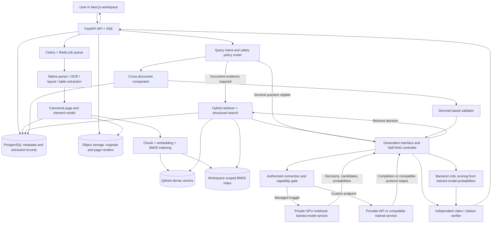
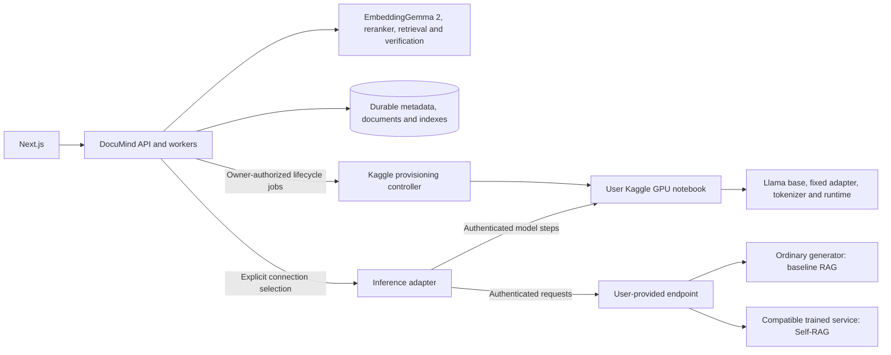

# ARCHITECTURE.md

## 1. Purpose and relationship to source

DocuMind AI adapts the supplied *Self-RAG Project Spec* (7 pages; `reference/original_self_rag_spec.pdf`) into a **multimodal document intelligence and cross-document verification** application. It preserves the PDF's Llama 3.2 3B QLoRA research target, hybrid retriever, reflection-token branching and naive RAG comparison. It extends the corpus, ingestion, storage, APIs, UI and evaluation. The departure list is in [`docs/CHANGES_FROM_PDF.md`](docs/CHANGES_FROM_PDF.md).

The full figure is a **target architecture**. Phase 0/1A now has a local native-PDF backend, Alembic schema, durable worker/dispatcher and private filesystem object-store adapter (ADR-022). [LOCAL_DEVELOPMENT.md](docs/LOCAL_DEVELOPMENT.md) lists actual routes and commands. Retrieval, UI workspace, OCR, inference and Kaggle components remain planned.

## 2. Logical architecture



The figure is **logical**, not a declaration of separate application microservices. Keep the application as a modular FastAPI monolith plus workers. The generation interface calls the selected external model service; the critic block computes scores from that trained generator's probabilities, not a separate LLM. Native ingestion requires no model service. A fully local installation uses the same boundary with a local endpoint.

### Deployment boundary



The controller manages only resources created for that connection; the model endpoint receives no Kaggle credentials or database access. Kaggle provisioning is separate from inference and never occurs implicitly on a query. Managed hosting is a gated target; quota/expiry/platform permission remain external constraints. [INFERENCE.md](docs/INFERENCE.md) owns this boundary. In local deployment, APP/LOCAL/DB and optionally the compatible model endpoint run on the user's machine; no external generation key is required for a local trained runtime.

## 3. Data flow A: upload and index

1. UI requests a document upload for an authorized workspace; API validates MIME type, extension, size and upload limits.
2. Original file is durably stored with SHA-256. Commit request idempotency key, document, queued extraction version and durable job together; a dispatcher submits job IDs to Celery and recovers missed dispatches.
3. A leased Celery attempt moves extraction to `processing`, extracts native text with PyMuPDF, and uses the local PaddleOCR adapter for image/low-text pages when enabled. Stage writes are idempotent and fenced by lease token.
4. Phase 1B uses PyMuPDF for native ruled tables and OpenCV grid geometry plus PaddleOCR for scanned ruled tables. Store page/element geometry, extraction identity, confidence and cell coordinates. OCR/table output requires review; Docling, general layout and automatic cross-page table linking remain extensions (ADR-024).
5. Normalize documents into canonical pages/elements; retain raw extraction separately from any model interpretation.
6. Commit validated immutable extraction records and preview availability independently of indexing. Phase 1A stops here; needs-review output remains preview-only.
7. Phase 2 constructs chunks using the encoder-safe profile in RETRIEVAL.md and builds both indexes into an immutable workspace publication. Verify identical membership, then transactionally advance the PostgreSQL publication pointer. Only that published version becomes searchable. Old published versions remain usable during failed reprocessing; deletion revokes access immediately.

The full dispatch/lease/publication protocol is authoritative in [docs/INGESTION.md](docs/INGESTION.md). Extraction state, index state and derived visibility are defined in [docs/DATA_MODEL.md](docs/DATA_MODEL.md). No distributed transaction across PostgreSQL, object storage and Qdrant is assumed.

**Correctness constraints:** A citation must remain resolvable after chunks are reindexed. Source `element_id` and page anchor must not be replaced by a fabricated passage label. Keep parser and embedding versions so the same upload can be reproduced.

## 4. Data flow B: document QA

1. UI creates a query with question, document IDs, mode and an idempotency key. API persists a queued run/job and returns 202; the browser polls the result or subscribes to GET events. Pin the authorized document set, publication, connection configuration version and admitted model/release identity once. Model-backed runs require the selected connection to support the resolved mode.
2. Policy router classifies `GENERAL`, `DOCUMENT_QA`, `CROSS_DOCUMENT`, `CALCULATION`, or `UNSUPPORTED`; any selected-document fact request forces evidence retrieval.
3. Baseline path retrieves hybrid top 5 passages and applies the bounded evidence-v1 verifier. Direct field answers and calculations require verified typed facts; broader unsupported questions abstain even when search returns hits. Identity, raw quote validity and substantive support are separate checks in [docs/EVIDENCE.md](docs/EVIDENCE.md).
4. The optional trained path follows selfrag-v1: decode a decision, apply policy once, retrieve or reuse evidence, generate bounded candidates, score and independently verify them. V1 stops/restarts reconstructed contexts, uses greedy segment selection and detects repeated identical retrievals. The shared retrieval-attempt cap is 3; the protocol declares deviations from the paper.
5. Citation verifier checks that cited passages were retrieved, belong to the authorized workspace, map to source pages and substantively support the claims. It can mark `insufficient_evidence` or return an abstention.
6. On model/connection failure, persist an explicit error. A different provider or a downgrade from Self-RAG requires user selection and a new run; never silently forward evidence elsewhere.
7. Persist ordered trace events and exactly one durable terminal answer/error outcome. GET SSE replays with sequence cursors and may redeliver events; clients deduplicate. Disconnect does not restart/cancel work, explicit cancellation does. Trace metadata excludes hidden reasoning and raw unverified answer tokens. See [docs/API_CONTRACT.md](docs/API_CONTRACT.md).

**Important distinction:** A fully streamed token-by-token loop may need custom model control rather than a naive `pipeline()` call. Implement and test generation boundaries and context-injection semantics explicitly; do not treat a log of tags as equivalent to model control.

## 5. Data flow C: discrepancy investigation

1. First implement invoice/PO grand totals with exact explicit identifiers, currency and total basis under grand_total_match_v1 in EVIDENCE.md. Contract clauses, tax recomputation, amendments and fuzzy linkage are later rules. Never assume document type from filename.
2. A **record linker** proposes matches via explicit keys first (PO number, vendor ID, line item codes), then scored candidate matches. Uncertain matches are flagged for review.
3. Fetch relevant structured records and their original evidence chunks; perform decimal calculations and comparison rules.
4. Produce findings such as `AMOUNT_MISMATCH`, `TAX_MISMATCH`, `MISSING_PO_LINE`, `DATE_CONFLICT`, `CURRENCY_MISMATCH`, `UNVERIFIED_MATCH`.
5. Render the computed findings from verified templates without a model dependency. Optional model explanations use a separately selected baseline query, must pass the evidence gate and cannot change numeric values or certify an unverified match.
6. Export a report only from the persisted, evidence-backed findings.

## 6. Components and responsibilities

| Component | Input -> output | Hard rule |
|---|---|---|
| `ingestion` | File -> pages/elements/tables | Preserve original and provenance |
| `indexing` | Elements -> indexed chunks | Rebuildable, versioned and workspace scoped |
| `retrieval` | Query + scope -> ranked passages | Qdrant + BM25 + RRF k=60 + cross encoder |
| `query_router` | Query + scope -> intent/policy | Document-specific queries cannot skip retrieval |
| `inference_connections` | Owner-authorized connection -> ready, capability-checked runtime | Pin identity; no silent provider/mode switch |
| `kaggle_controller` | Explicit start/stop -> reconciled owned notebook/endpoint | Secret isolation, durable jobs, platform gates |
| `baseline_generator` | Query + passages -> answer | No invented citations |
| `self_rag` | Query + state -> token/log/answer | Fine-tuned checkpoint + real control loop |
| `structured_extraction` | Elements -> typed records | Confidence, origin and parsing errors explicit |
| `comparator` | Record sets -> match candidates | Do not silently infer entity identity |
| `numeric_validator` | Typed values -> deterministic findings | `Decimal`, currency and rounding aware |
| `evidence_verifier` | Claims -> support mapping | Evidence belongs to source corpus/scope |
| `reporting` | Verified findings -> export | Cite each finding; disclose missing support |
| `evaluation` | Frozen dataset + configs -> outputs | Save per-question raw predictions and metrics |

## 7. Runtime and data stores

- **Next.js** is the product UI. It uses direct PDF page viewing + bounding box overlays, ingestion status, answer cards, compare UI and SSE trace. No API secrets exposed client-side.
- **FastAPI** is the single public backend. It validates workspace and upload permissions, starts jobs, reads status, handles query streaming and returns records.
- **PostgreSQL** is the source of truth for users/workspaces, document metadata, pages, elements, chunks and citations, extracted records, investigations and evaluations.
- **Object store** contains originals, derived images and immutable report artifacts. Phase 1A uses a private filesystem adapter on a shared persistent local volume (ADR-022); a hosted S3 adapter is later work.
- **Qdrant** contains vector payloads keyed by stable `chunk_id`, `document_id`, `workspace_id`, `ingestion_version`.
- **BM25** uses the **same logical chunk corpus** and must enforce workspace/document filters. `rank_bm25` is an in-memory library; the plan must include persistence/rebuild strategy rather than pretending it is a distributed service.
- **Celery + Redis** handles parsing, OCR, extraction and indexing. Retries must be idempotent.
- **LLM runtime** is selected through INFERENCE.md: managed Kaggle or custom endpoint. Our trained service uses FastAPI + Transformers/PEFT with a fixed release, returning decisions/candidates/scores to the backend controller. Ordinary provider endpoints support baseline without another local Llama. CPU generation is an explicitly tested slow demo option, not a guaranteed deployment.

## 8. Ranking contract

Production profile `hybrid-v3`: reranker-tokenized chunks (240 content tokens / 64 overlap), dense `google/embeddinggemma-2` (text-only, normalized 768-dimensional vectors), BM25 via `rank_bm25`, RRF `k=60`, cross encoder rerank **top 20**, return **top 5**. The PDF's 512/64 settings remain only in the opt-in, explicitly truncating `source-512-v1` experiment (ADR-011); ADR-020 supersedes the MiniLM embedding default. See `docs/RETRIEVAL.md` for exact tie breaking, filters and failure modes. Cross-document comparisons also query SQL structured fields; this **extends** the PDF.

## 9. Reflection-token contract

PDF names four categories `[Retrieve]`, `[IsREL]`, `[IsSUP]`, `[IsUSE]`. They are **shorthand categories in the supplied PDF**, not a complete tokenizer/label specification. The selfrag-v1 design freezes exact strings, state transitions, episode serialization, loss masks and scoring; implementation probes must pass before bulk annotation. It is explicitly a Self-RAG-inspired adaptation, not exact paper reproduction. Do not announce paper-faithful reproduction until verified. Full spec: `docs/SELF_RAG_SPEC.md`.

## 10. Reliability and security

- Degraded states: parse failure, unsupported file, OCR confidence below threshold, empty retrieval, missing/contradictory evidence, GPU unavailable and retrieval budget exhausted.
- Every user-visible conclusion can indicate `supported`, `partially_supported`, `insufficient_evidence` or `unverified`.
- Uploaded content is never trusted as system instructions. Enforce workspace isolation at SQL, vector and sparse retrieval levels.
- Require audit traces for a retrieval decision but never expose private hidden chain of thought or sensitive system prompts.
- No external upload/annotation of sensitive documents unless user-approved provider and privacy policy are configured.

## 11. Projected repository structure

```text
documind-ai/
  AGENTS.md, README.md, ARCHITECTURE.md, IMPLEMENTATION.md
  docs/...
  frontend/
    app/, components/, lib/, tests/
  backend/
    app/main.py
    app/api/v1/{documents,queries,investigations,reports,inference_connections}.py
    app/core/{config,security,logging}.py
    app/db/{models,repositories,migrations}/
    app/services/{ingestion,indexing,retrieval,baseline,self_rag,inference,reasoning,citations}/
    app/workers/
    tests/{unit,integration}/
  model_service/  # Phase 6 only; complete trained runtime API
  training/{annotation,finetune,eval,configs}/
  evaluation/{datasets,baselines,metrics,reports}/
  infra/{docker,compose}/
  scripts/
  reference/original_self_rag_spec.pdf
```

Codex may create concrete modules as development proceeds. Do not fill directories with placeholders and call it working.

## 12. Release boundaries and explicit assumptions

The baseline product (Phases 0, 1A, 2, 3) and comparison product (Phases 4, 7, plus 1B for scans/tables) have release gates independent of Phases 5-6 training. Phase 8 combines completed product and research evaluations. Small fixture evaluations run at each earlier gate; model/hardware smoke checks precede promises about generation performance.

- **MVP user model:** local development with one workspace is acceptable, but isolation semantics must already exist. Public/multi-user release requires real authentication and authorization.
- **Supported input sequencing:** native PDF -> scanned PDF/image -> DOCX -> CSV/XLSX. File formats are staged, not all day-one features.
- **Inference hardware:** the proposed 2-vCPU/16-GB app host targets bounded embedding/reranking and application work; generation is offloaded by default. No throughput or full-stack memory claim has been measured. Durable storage must outlive an ephemeral host. Kaggle platform permission, actual quotas, training GPU and model-serving compatibility remain gates. Phase 6K adds managed Kaggle after Phase 6 and does not block product releases.
- **Tables:** low-confidence OCR/table extraction triggers source-side review, not automatic factual claims.
- **All external datasets and models:** use only after verifying licenses, access, PII restrictions and versioned references.
