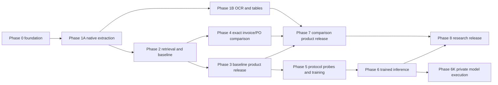

# IMPLEMENTATION.md - executable engineering plan

**This file is the staged build plan.** The local app implements the Phase 0/1A foundation, bounded Phase 1B PDF extraction, Phase 2 retrieval and baseline QA, the Phase 3 workspace and Phase 4 exact invoice/PO comparisons under ADRs 024–027. Current checks and deployment limits are in PROGRESS.md and docs/LOCAL_DEVELOPMENT.md. Baseline retrieval and document ingestion precede QLoRA, as recorded in `docs/CHANGES_FROM_PDF.md` (D10). The optional 16-week estimate depends on hardware and document complexity.

ADR-042 makes all application releases local-only. Fine-tuned reflection runs on the device or private Kaggle. Generation independently uses a local service, private Kaggle bridge or endpoint/key. The split path, local model services and inference bridge are implemented. Their measured validation and remaining quality gates belong in PROGRESS.

## 0. Build strategy

- **Lane A: application foundation**. Ingest -> preserve provenance -> index -> retrieve -> cite -> compare. It must remain functional without Self-RAG training.
- **Lane B: research**. Construct annotations -> fine-tune reflection model -> implement branch/critic loop -> compare fairly with Lane A.
- **Lane C: product/UI**. Workspaces, visual viewer, trace panel, investigation and report. Build once backend contracts stabilize.

The first deliverable is a tiny complete vertical slice, **not** a directory tree with empty classes.

### Milestone dependencies

Phase numbers preserve existing references; they are not a mandatory linear schedule. Phase 3 ships independently of OCR/training. Phase 7 ships independently of training. Run fixture evaluation at every gate; Phase 8 adds the final research comparison, not the first evaluation. The 16-week estimate is optional planning context, not an acceptance criterion. Phase 2/3 implements custom-endpoint baseline inference; Phase 6 implements the compatible trained model API. Phase 6K implements the explicit local Kaggle bridge after platform/security gates and does not block Phases 3, 7 or research evaluation on another compatible runtime.

## Phase 0: foundation and environment (week 1)

**Deliver**: Python backend project, local service configuration, implemented environment loader, migrations and test harness. A Next.js shell is optional here; its functional UI belongs to Phase 3.

Tasks:
1. Initialize only the backend, infra and tests needed for the first slice, with CI and locked dependencies. Add training/frontend modules when their milestones need them; document GPU extras separately.
2. Define configuration for PostgreSQL, Redis, Qdrant, object store, model mode, extraction thresholds and max upload size. Keep inference and managed Kaggle disabled; Phase 0/1A requires no API keys, model downloads or endpoint credentials. Add connection tables/secrets integration only in their later milestone. No embedded secrets.
3. Configure PostgreSQL, Redis, private local object storage and Qdrant in Compose. Create the Phase 1A subset of DATA_MODEL.md: workspace/document/version, durable jobs/request keys, immutable pages/elements and scoped constraints. Add publication/chunk/query tables with their later capabilities; no empty service placeholders.
4. Provide `GET /api/v1/health`, capability-aware `GET /api/v1/ready`, structured logging and standard errors. Previews do not require Qdrant or a GPU.
5. Implement workspace scoping in repository interfaces even if local MVP only uses one workspace.

Acceptance gate:
- [x] Clean copied-source startup with new config/volumes starts API, database, queue and Qdrant; no Git clone assumed.
- [x] Migration up/down tested on an empty database.
- [x] Unit tests and one API integration test pass.
- [x] Structured request logs with request IDs are actually emitted under the documented Uvicorn/Compose startup (review finding F3).
- [x] No real `.env` credentials, confidential uploads, API keys or model weights in Git. `.env.example`, the owner-supplied `reference/original_self_rag_spec.pdf` and licensed synthetic test fixtures are permitted. Do not apply a blanket PDF ban.

## Phase 1A: native PDF extraction and preview

This is the first required vertical slice, paired with Phase 0. It does not require OCR, tables, search indexes or model weights.

Tasks:
1. Implement the idempotent native-PDF upload, original storage and durable DB job/dispatcher protocol in INGESTION.md.
2. Extract native text, raw offsets and normalized geometry with PyMuPDF; validate scoped relational provenance before promoting immutable records.
3. Implement workspace-scoped document/job/page/element/image reads, with explicit extraction versions. Complete extraction makes previews available while indexing remains not_started.
4. Handle corrupt, empty, encrypted/unsupported and image-only PDFs explicitly. Scans return needs_review or an actionable unsupported-extraction error; never invent OCR.
5. Add tiny licensed synthetic fixtures, rotated-page cases, crash/retry tests and migration integrity tests. Preserve previous completed versions during reprocessing.

Acceptance gate:
- [x] Upload -> durable job -> exact page text/geometry -> preview works with indexing disabled.
- [x] Repeated/concurrent upload with the same request key returns one document/job; conflicting reuse is rejected.
- [x] Queue outage, crash before dispatch and duplicate delivery recover without duplicated visible elements.
- [x] Extraction is complete with preview_available=true and searchable=false; failed reprocessing preserves the old preview.
- [x] Wrong workspace/document/page/version combinations are rejected, not merely caught in UI.
- [x] Element pagination traverses all elements without duplicates or omissions (review finding F2).
- [x] Page and element text reads recheck visibility when deletion commits during a read, before returning source content (review finding F1; both routes regression-tested).

## Phase 1B: OCR and tables (after 1A; independent of baseline release)

1. Add configurable scanned-page detection, rendering and PaddleOCR fallback with source origin/quality; use Docling for broader layout/tables only after compatibility tests. ADR-024 implements bounded ruled tables with PyMuPDF/OpenCV first.
2. Preserve table cell geometry, reading order, headers and row/column structure. Low-confidence extraction remains preview-only until a reviewed version completes.
3. Measure OCR/table quality on labeled fixtures; do not declare confidence thresholds calibrated without measurements.

Acceptance gate:
- [x] Image-only fixture has actual OCR provenance or explicit failure; no fake empty successful extraction.
- [x] Table cells retain source geometry and row/column identity.
- [x] Review/correction creates a new immutable extraction; prior citations still resolve.

The [Phase 1B audit findings](docs/validation/phase1b-review-2026-11-08.md) now have passing regressions in `backend/tests/test_extraction.py`.

- [x] Preserve visible text on both sides of a native table (F1).
- [x] No-edit review preserves existing reading order across all four PDF rotations (F2).
- [x] Selecting an already-completed review version cannot leave latest and default preview permanently inconsistent (F3).
- [x] Same-key/body upload replays survive unavailable OCR artifacts without creating duplicate work (F4).
- [x] Complete single-row and single-column raster grids retain table-cell structure (F5).
- [x] A boundary-centered OCR line is assigned at most once or explicitly retained as ambiguous (F6).

Implemented scope: PDFs, English CPU OCR at 144 DPI, native ruled tables (including tested merged headers), complete rectangular raster grids, explicit header uncertainty and human text/header review. OCR/table output remains needs_review until explicit whole-document review. Multi-page table linking, unruled/ragged scans, general layout and representative confidence calibration remain extensions; synthetic fixture metrics are not production accuracy. See ADR-024 and INGESTION.md.

DOCX/CSV/XLSX and additional image formats are extended-format milestones, not blockers for the native slice or baseline product. Each needs its own source-locator and adapter tests.

## Phase 2: search + naive RAG baseline (weeks 4-6)

Tasks:
1. Implement hybrid-v3 exactly as RETRIEVAL.md: pinned tokenizers, 240 reranker content tokens / 64 overlap, dense and reranker encoded-length checks, offsets and zero silent truncation. The historical source-512-v1 profile is optional and separately labeled.
2. Compute embeddings using `google/embeddinggemma-2` in text-only mode, with the fixed search/document formatting, normalized 768-dimensional vectors and a versioned collection from RETRIEVAL.md. Qdrant point payload includes authorized workspace/document IDs. Missing/incompatible weights fail explicitly; never silently fall back to MiniLM.
3. Build matching workspace/publication dense and BM25 snapshots; verify membership and atomically publish the DB pointer. Test failure between index writes, publication races and deletion during queries.
4. Implement RRF `k=60`; rerank up to 20 candidates with `cross-encoder/ms-marco-MiniLM-L6-v2`; return top 5.
5. Implement the pinned-publication retrieve interface in RETRIEVAL.md with deterministic ranking and explicit failures.
6. Implement evidence-v1 bounded baseline answers and abstention, durable query creation/results and persisted traces. Model-generated candidate prose passes the independent claim gate or falls back to verified templates. Record model/runtime availability honestly; template-only tests do not establish a working model baseline.
7. Implement the custom_endpoint portion of INFERENCE.md/API_CONTRACT: principal/workspace scoping, immutable connection versions, secure credentials, SSRF-safe validation and one tested ordinary chat provider adapter. Pin model/connection identity per query; templates do not count as model availability. The application verifies provider output independently.
8. Establish the 50-question retrieval development set and unanswerable/wrong-field negatives. Pin a separate held-out grouped manifest before tuning; run model/tokenizer load smoke checks on intended hardware and record memory/latency, or mark generation blocked.

Acceptance gate:
- [x] Custom-endpoint baseline returns a verified source and enforces destination and deletion controls before sending evidence. Real loopback inference and both first-write/deletion orderings pass. Site-local IPv6 is rejected.
- [x] Selected embedding profile passes real model load, formatting, dimensions, identity rejection and hybrid publication checks on the development host. The recorded development evaluation identifies the checkpoint and runtime.
- [x] Relevant chunk reaches top 5 for predefined small test fixture.
- [x] A passage from workspace B never appears in workspace A results.
- [x] Exact ID search and semantic paraphrase search each have positive fixtures.
- [x] Empty and nonempty irrelevant search, wrong-field quotes, unsupported approval claims and ambiguous fields abstain. The two audit cases, existing negatives and tail-of-chunk tests pass.
- [x] Accepted queries return 202 once and produce verified raw-span citations and traces. Snapshot recovery preserves eligible survivors and readiness reflects mismatched artifacts. The recovery migration backfill is exercised with existing publication data.

Phase 2 is exercised locally with real CPU embedding/reranking, Qdrant, Redis/Celery, PostgreSQL and loopback model completions. The six [audit findings](docs/validation/phase2-review-2026-11-08.md) have permanent regressions. External-provider credentials, representative corpus performance and the intended production host require deployment verification. JSON polling and Phase 3 SSE use the same event ledger. The grouped synthetic development and held-out manifests are in `backend/tests/fixtures`.

## Phase 3: user interface and observable traces (weeks 6-8)

Tasks:
1. Add workspace and document list, upload progress/status, PDF viewer and source highlights.
2. Build chat with cited answers linking to page/element; return document and chunk identifiers in citation metadata.
3. Implement SSE trace stream with `retrieval_started`, `passage_found`, `passage_filtered`, `generation_started`, `citation_verified` and final answer.
4. Show baseline vs trained Self-RAG comparison **only after** a trained checkpoint actually exists; until then label research mode unavailable.
5. Add visible `insufficient evidence`, extraction error and job failure states.
6. Add connection setup and mode/capability display. Offer custom-endpoint baseline; show managed Kaggle unavailable until Phase 6K. Explicitly select a new connection/run after failure; display the destination for evidence and provide credential replacement/revocation.

Acceptance gate:
- [x] Upload -> ask -> click citation -> highlighted source works end to end in Chromium with real extraction and retrieval.
- [x] GET SSE reconnect/replay, client deduplication, cancellation and worker restart are tested. Replay includes a run that finishes during disconnection. Queued deadlines terminate without a worker.
- [x] Baseline traces contain persisted retrieval/verification events and no invented reflection-token messages.

The workspace uses authorized page renders and source geometry. Chromium exercises endpoint setup and revocation, trace replay, lost upload receipts, review-version binding, quota failures, deleted sources and a 390-pixel layout. The browser completion endpoint is synthetic. Backend tests separately exercise a real SmolLM2 model. The six findings and both smaller API discrepancies have regression coverage. [Phase 3 audit and resolution](docs/validation/phase3-review-2026-11-09.md).

## Phase 4: cross-document verification (weeks 7-10, can overlap)

Tasks:
1. Implement grand_total_match_v1 from EVIDENCE.md: exact PO/vendor identifiers, verified grand totals, explicit common currency and total basis. Add raw/typed records and evidence anchors.
2. Reject missing/ambiguous linkage with UNVERIFIED_MATCH; no fuzzy matching in the first comparison release.
3. Use Decimal, finite/range checks, exact subtraction and zero tolerance under the versioned first rule. Tax recomputation, currency conversion, contract amendments and line-item rules require later versions and fixtures.
4. Add SQL-backed structured retrieval and investigation API; store findings and evidence pairs.
5. Implement evidence verifier that rejects nonexistent or unauthorized references and marks claims unresolved on weak extraction.
6. Generate deterministic comparison results and cited report export (PDF/CSV as appropriate); verify source and computed totals independently.

Acceptance gate:
- [x] Fixture with matching PO/vendor IDs and common currency/basis gives an exact INR 100.00 difference between 1100.00 and 1000.00, with both citations and a matching CSV.
- [x] Ambiguous PO matches produce `UNVERIFIED_MATCH`.
- [x] Missing currency or ambiguous tax basis produces a needs-review finding.
- [x] Both cited source pages open at the original evidence in Chromium. Deletion revokes the finding and CSV.

The comparison works before search publication and with generation disabled. It supports the bounded grammar in [EVIDENCE.md](docs/EVIDENCE.md#4-first-comparison-rule-grand_total_match_v1). [Local setup](docs/LOCAL_DEVELOPMENT.md#phase-4-deterministic-comparison).

## Phase 5: supervised reflection annotations and QLoRA (weeks 8-11)

**Prerequisite:** Phase 3 baseline product + grouped corpus + frozen held-out test set. This lane does not block Phase 7.

The offline pipeline implements the serializer, target masks, trajectory validation, PEFT training, checkpoint reload, separate raw and constrained decision scoring, and checkpoint-bound manual review. CPU FP32 and Kaggle T4 NF4 probes trained and reloaded the pinned open SmolLM2 base with a reflection adapter. The target is Qwen3-4B-Instruct-2507 under ADR-031. The expanded synthetic corpus, model run and human review have separate validation gates. [Training runbook](docs/LOCAL_DEVELOPMENT.md#phase-5-offline-reflection-training) · [Pilot results](docs/validation/phase5-pilot-2026-11-09.json).

Tasks:
1. Implement selfrag-v1 protocol/serializer/label masks and tiny train/save/reload probes before bulk annotation. Review paper §3.2, §3.3 and Appendix A.3; retain the declared adaptation differences. Record a protocol hash and probe artifacts.
2. Construct domain-specific training data with query, eligible retrieval policy, source passage(s), answer, retrieval decision, relevance/support/usefulness labels and provenance.
3. Model-annotated data may use GPT-4o-mini/Gemini Flash (as source PDF proposes) only with user-approved privacy settings and recorded provider/version; sample and review labels manually.
4. Build counterexamples: unnecessary retrieval, hard negative passages, partial support, no support, conflicting documents, absent records. Keep leaked source content out of test splits.
5. Implement an **initial goal**, not a promise, of about 5K curated annotated pairs. Do not pad counts with duplicates.
6. Train `Qwen/Qwen3-4B-Instruct-2507` via 4-bit QLoRA with PEFT/bitsandbytes; use the PDF's `r=16`, `3` epochs as an experiment starting point, not immutable hyperparameters.
7. Save the immutable release bundle in INFERENCE.md: exact base revision, adapter/checkpoint, trained token rows, tokenizer/token map, serializer/protocol hashes, runtime/precision, training metrics and evaluation references. Secure model license and access first. Uploads and queries never retrain it; publish upgrades as new releases.
8. Run minimum 20 manual probe cases **and** machine-scored held-out reflection accuracy tests.

Acceptance gate:
- [x] The pinned smoke and Qwen tokenizers roundtrip all 15 registered labels.
- [x] Pilot train, validation and test sources, groups and templates are separate. Corpus hashes are frozen before training.
- [x] The pinned Qwen QLoRA checkpoint reloads all 15 rows and generates the expected initial probe tokens in the selected run.
- [x] Qwen retrieval-needed and safe-to-skip probes have a labeled confusion matrix, recorded outputs and manual review. The selected synthetic v3 run has 20 validated formal verdicts across both policies. Application quality and release approval remain separate gates. [Scored runs](docs/validation/phase6-adapter-v3-2026-11-09.json) · [Human review](PROGRESS.md#selected-adapter-human-review--2026-11-09).
- [x] Results disclose model, data, method and limitations.

## Phase 6: actual Self-RAG control engine (weeks 10-12)

The private PEFT model service and durable application loop have passed engineering acceptance for the immutable v4 NF4 checkpoint. Both the experimental 73-case workflow and ordinary reviewed-runtime admission were exercised with real target GPU steps. The split pairing uses the independently pinned Qwen FP16 MPS generator. Results, the remaining adversarial answer-coverage miss and explicitly delegated agent review are in [current validation](PROGRESS.md#phase-6-validation--2026-11-15) and [the measured report](docs/validation/phase6-validation-2026-11-15.json). These synthetic checks do not certify a representative research release or other model profiles. The [43/46 v3 run](docs/validation/selected-pdf-workflow-2026-11-09.json) remains historical evidence.

The final v4 review accepted opt-in local experimental use with the tested `nf4-cuda` reflection profile. The trained `fp16-mps` attempt on the acceptance Mac timed out during candidate generation. [Final release decision](docs/validation/local-release-2026-11-15.json).

Tasks:
1. Implement the FastAPI + Transformers/PEFT documind-runtime-v1 service in INFERENCE.md, with capability checks, authenticated bounded steps, complete reflection-family scores and cancellation. Keep policy/retrieval/verification in the application; reconstruct context per step. Load the approved trained release once; test local transport and a real remote runtime. Ollama is not presumed compatible.
2. On eligible `[Retrieve]` action: stop current model generation, retrieve top 5 within workspace scope, inject evidence, generate candidate segments, parse critic labels and score candidates.
3. Implement critic-v1 probabilities, weights, hard support gate and stable tie rules from SELF_RAG_SPEC.md. Continue reuses evidence; mandatory retrieval is not repeated for every segment. Any tuning creates a recorded scoring revision on validation only.
4. Enforce max 3 retrieval calls per query, max generated tokens, context budget, timeout, cycle detection and no unsupported token state.
5. Enforce mandatory retrieval policy for private/document-specific queries even when model predicts skip. Record `requested_model_action`, `effective_action` and `policy_override_reason` separately as specified in SELF_RAG_SPEC.md.
6. Return `answer`, `citations`, `tokens_log`, `trace_id` and `mode=self_rag` only on the trained, tested path.

Acceptance gate:
- [x] TESTING scenario O engineering checks pass for the immutable trained release under the recorded local experimental operator trust basis (ADR-044), including missing token rows, manifest mismatch, budget recovery and local-without-external-provider-key behavior.
- [x] Application integration verifies a retrieval action causes a real scoped search and changes candidate context.
- [x] The eligible skip branch makes zero retrieval calls.
- [x] Repeated identical retrieval stops as a cycle within the three-attempt budget.
- [x] Irrelevant or unsupported candidates cannot create verified citations.
- [x] The trace separates model actions and policy overrides.

## Phase 6K: private Kaggle model execution (after Phase 6)

This is optional model compute for the local application. Baseline and comparison remain independent. GPU allocation and quota depend on the user's Kaggle account and platform availability.

The private Jupyter probe persists allocation deadlines and creation receipts. ADR-042 adds an explicit local bridge for either model role. It uses existing cancellation and model-process guards. The app keeps its stores on the device and connects to inference through loopback. [Model setup](docs/LOCAL_DEVELOPMENT.md#local-only-model-setup).

1. Verify model rights and permitted private notebook inference using the configured local account. Provision explicitly and keep credentials in local private state.
2. Use local Kaggle CLI credentials, private state, fixed notebook templates, checked release loading and an authenticated loopback inference bridge. Reconcile notebook/session identity before retrying provisioning.
3. Verify runtime identity/capabilities before ready. Track expiry, quota, gateway loss and cleanup. Model startup is separate from the query deadline.
4. Select generation endpoints explicitly after unavailability. Stop/reconcile Kaggle with local commands and revoke generation connections through the workspace. Preserve truthful cleanup status.

Acceptance gate:
- [x] TESTING scenario P technical checks pass with authorized live Kaggle access, plus deterministic fault-injection tests.
- [ ] Platform permission, secret handling, private visibility and actual stop/cleanup behavior are documented.
- [x] Quota/expiry/revocation fail explicitly and never expose credentials or start duplicate notebooks.
- [x] The local bridge exposes inference routes only and preserves configured local account ownership and exact-session cleanup during interruption.

## Phase 7: product integration and reporting (weeks 12-14)

The local comparison release uses the existing pinned investigation and cited CSV flow. It adds a bounded workspace quota, browser deletion, recovery after an interrupted submission and revalidation of open evidence. The retrieval path retains cached model loading and rebuildable dense and lexical snapshots. [Acceptance evidence](docs/validation/phase7-acceptance-2026-11-15.json).

Tasks:
1. Integrate multiple documents, comparison page, investigation cards and evidence viewer. Prerequisites: Phases 3, 4 and 1B for scanned/table demos; no Phase 5/6 dependency.
2. Implement report generator from frozen, verified finding records with page citations.
3. Add granular failure handling, upload quotas and clean state transitions.
4. Optimize heavy pipelines with caching/rebuildable indexes; preserve reproducibility and correctness.

Acceptance gate:
- [x] Exact invoice + purchase order comparison demo runs without developer intervention or active inference. A contract may be viewed/cited, but automated contract-term validation is explicitly outside the first rule.
- [x] Report numbers equal validator numbers, independent of model prose. The local browser run exported the exact INR 100.00 difference and both evidence rows.
- [x] Two populated workspaces see only their own investigations, source anchors and reports. Foreign IDs and mixed-source selections are denied.

## Phase 8: combined research evaluation and handoff (after Phases 6 and 7)

Tasks:
1. Use the pre-training frozen 200-question document QA research test set covering eligible skip, mandatory retrieval, missing evidence and cross-document questions; maintain separate specialized datasets for field/tables/arithmetics.
2. Compare naive RAG and Self-RAG using **same** base family, source documents, retrieval configuration and defined compute budget; disclose adapter differences.
3. Evaluate faithfulness, answer correctness, skip accuracy, decision confusion matrix, retrieval rate, latency percentiles, citation precision and recall.
4. Run ablations: dense only, BM25 only, hybrid without reranker, hybrid reranked; with/without support critic; optional forced retrieval.
5. Evaluate OCR, tables, key fields and discrepancy labels on separate ground truth fixtures.
6. Export per-query results CSV/JSONL, summary report, configs, seeds, example traces. Publish only measured numbers.
7. Containerize reproducible setup; demonstrate startup from fresh clone and document GPU/cloud costs and license prerequisites.

Acceptance gate:
- [x] Baseline and Self-RAG results are reproducible from frozen evaluation manifest for the controlled 200-case post-training and 60-case pre-training cohorts.
- [x] Failure cases and limitations appear in README; statistics are sourced from actual saved artifacts.
- [ ] Clean setup + signature demo pass the release checklist in `docs/TESTING.md`.

The selected v4 checkpoint has a 60-question pre-training split. The broader 200-case grouped `phase8-v1` manifest was frozen separately after selection and before paired scoring. Keep both cohorts and their provenance separate. A representative pre-training 200-case benchmark requires a future checkpoint selected without that holdout. [Protocol and reproducibility](docs/EVALUATION.md#10-phase-8-controlled-comparison).

The local suite and native export passed the setup and signature-demo scenarios. Publication and remote CI from a committed release remain open. The controlled measurements and ablations are complete, while blinded human review, RAGAS and representative pre-training data remain research gates. [Measured results](docs/validation/phase8-benchmark-2026-11-15.md).

## 1. Current task queue for Codex

Items 1–11 have passed local product checks. PROGRESS.md records observed checks and deployment limits for the product and research work.

| Order | Work item | Deliverable | Depends on |
|---|---|---|---|
| 1 | Project + Docker Compose bootstrap | Startable local services, health endpoints | None |
| 2 | Schema + migration | Workspace/document/page/element tables | 1 |
| 3 | Native PDF ingestion | Upload, job status, PyMuPDF element extraction | 2 |
| 4 | Source viewer API | Page image and element/geometry endpoints | 3 |
| 5 | Chunking + Qdrant + BM25 | Indexed searchable corpus | 3 |
| 6 | RRF + cross encoder | `retrieve(...)` tested service | 5 |
| 7 | Grounded naive RAG + custom endpoint | Scoped connection, tested provider adapter, answer/citation/trace | 4, 6 |
| 8 | Next.js PDF viewer/chat | First end-to-end vertical slice | 7 |
| 9 | Scanned OCR + table adapter | New ingestion capabilities | 3 |
| 10 | Structured extraction + deterministic comparison | Auditable discrepancy detection | 3, 7 |
| 11 | Product reports/release | Independently usable comparison product | 8, 9, 10 |
| 12 | Protocol probes + label/data pipeline | Frozen serializer, masks and versioned annotations | 8 |
| 13 | QLoRA training | Checkpoint and label evaluation | 12 |
| 14 | Branch engine + trained model API | Real control loop and compatible immutable runtime | 6, 13 |
| 14K | Managed Kaggle connection | Automated private runtime lifecycle and explicit endpoint fallback | 14, platform/security gates |
| 15 | Self-RAG UI and compare mode | Visible real decisions vs naive RAG | 8, 14 |
| 16 | Combined research evaluation | Honest results and limits; requires earlier fixture results | 11, 15 |

## 2. Decisions Codex must not silently make

- Calling ordinary hosted chat output Self-RAG without an approved trained reflection checkpoint.
- Replacing cross encoder reranking with only embedding similarity.
- Trusting model generated numeric values over computed amounts.
- Discarding page/element provenance during text cleaning.
- Sending confidential uploads to annotation APIs without permission.
- Claiming a dataset provides paired invoice/PO/contract ground truth without checking.
- Optimizing retrieval skip rate by allowing private-document questions to skip retrieval.

## 3. Minimum developer commands (to implement and document)

The implemented local slice has exact commands for infrastructure, migrations, API/worker/dispatcher, OCR and retrieval setup, development evaluation, Next.js and browser checks in docs/LOCAL_DEVELOPMENT.md. Later milestones must add their own commands and observed results.
